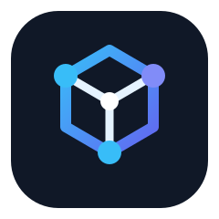

<div align="center">
  
  <h1>DevConnect</h1>
  <h3>Cloud-Native Developer Social Platform</h3>
  <p>
    An end-to-end microservices platform demonstrating modern cloud infrastructure,
    container orchestration, GitOps, CI/CD, security, and observability.
  </p>
  <p>
    <a href="http://54.203.189.79/"><strong>Live Application</strong></a>
    &nbsp;·&nbsp;
    <a href="https://github.com/tanahmeeedsx/end-to-end-microservice-project"><strong>GitHub Repository</strong></a>
    &nbsp;·&nbsp;
    <a href="https://linkedin.com/in/tanahmedd/"><strong>LinkedIn Profile</strong></a>
  </p>
</div>

<div align="center">


</div>

---

## Overview

**DevConnect** is a cloud-native social platform built for developers. Users can register, manage profiles, publish technical posts, share knowledge, and interact through likes and comments.

The application is structured as independent backend microservices built with **Python and FastAPI**, with a React frontend. PostgreSQL provides persistent storage, while Redis supports asynchronous background processing through a dedicated Worker Service.

Beyond application development, this project brings together infrastructure provisioning, containerization, Kubernetes deployment, GitOps delivery, security scanning, monitoring, and centralized logging in one practical end-to-end implementation.

## Project Links

| Resource | Link |
|---|---|
| Live Application | [http://54.203.189.79/](http://54.203.189.79/) |
| GitHub Repository | [end-to-end-microservice-project](https://github.com/tanahmeeedsx/end-to-end-microservice-project) |
| LinkedIn Profile | [Tanjim Ahmed](https://linkedin.com/in/tanahmedd/) |

## Project Tags

`Microservices` `DevOps` `Cloud Native` `AWS` `Terraform` `Docker` `Kubernetes` `K3s` `GitOps` `Argo CD` `CI/CD` `FastAPI` `React` `Redis` `PostgreSQL` `Prometheus` `Grafana` `Loki` `DevSecOps`

## Project Architecture

The following high-level flow illustrates how code moves through the delivery pipeline and how the deployed application components work together.

```text
                         Developer
                             |
                         Git Push
                             |
                      GitHub Actions
                             |
                 Tests & Build Validation
                             |
                  Security / Trivy Scans
                             |
                    Docker Image Build
                             |
                         Docker Hub
                             |
                 Kustomize Image Tag Update
                             |
                          Argo CD
                             |
                       AWS EC2 / K3s
                             |
                      Traefik Ingress
                             |
                       React Frontend
                             |
                        Nginx Routing
                             |
                    FastAPI Microservices
          +------------------+------------------+
          |         |        |       |          |
         Auth      User     Post    Like      Comment
                              |
                         Redis Queue
                              |
                        Worker Service
                              |
                         PostgreSQL

                  Observability & Monitoring
              Prometheus | Grafana | Loki | Alloy
                           cAdvisor
```

### Microservices

| Service | Responsibility |
|---|---|
| Frontend | React-based application interface and social feed |
| Auth Service | User registration, login, and authentication |
| User Service | User profiles and account information |
| Post Service | Creating and managing posts |
| Like Service | Handling post likes |
| Comment Service | Managing comments and interactions |
| Analytics Service | Application analytics and metrics |
| Worker Service | Processing asynchronous background jobs |

**Supporting infrastructure:** PostgreSQL for persistent data and Redis for queue-based communication.

## Technology Stack

| Area | Technologies |
|---|---|
| Frontend | React, JavaScript |
| Backend | Python, FastAPI |
| Database | PostgreSQL |
| Message Queue | Redis |
| Containerization | Docker, Docker Compose |
| Reverse Proxy | Nginx |
| Cloud Infrastructure | AWS EC2 |
| Infrastructure as Code | Terraform |
| Orchestration | Kubernetes (K3s) |
| Ingress | Traefik |
| CI/CD | GitHub Actions |
| Container Registry | Docker Hub |
| GitOps | Argo CD |
| Deployment Configuration | Kubernetes Manifests, Kustomize |
| Security Scanning | Trivy, OWASP Dependency-Check |
| Monitoring | Prometheus, Grafana |
| Logging | Loki, Grafana Alloy |
| Container Metrics | cAdvisor |

## What I Implemented

- Designed the application around independent backend microservices, separating authentication, users, posts, likes, comments, analytics, and background processing.
- Built and containerized the frontend and backend services using Docker.
- Configured service networking and Nginx routing between the application components.
- Implemented asynchronous post processing with Redis and a dedicated Worker Service.
- Used PostgreSQL for persistent application data.
- Provisioned AWS EC2 infrastructure using Terraform.
- Deployed the application on K3s and configured Kubernetes Deployments, Services, ConfigMaps, Secrets, and Ingress resources.
- Organized Kubernetes deployment configuration using Kustomize.
- Implemented GitOps-based continuous delivery with Argo CD.
- Built a GitHub Actions pipeline for tests, frontend validation, security checks, Docker image builds, image publishing, and GitOps manifest updates.
- Integrated Prometheus and Grafana for metrics and dashboards.
- Configured Loki and Grafana Alloy for centralized log collection.
- Used Trivy to scan the repository and container images for vulnerabilities.

## Challenges & Solutions

Working on a distributed application introduced practical issues across the development and deployment lifecycle. Some of the areas I investigated and worked through:

| Challenge | Troubleshooting approach |
|---|---|
| Docker image build issues | Reviewed Dockerfiles, dependencies, build contexts, and image configurations |
| Container-to-container communication | Inspected Docker networks, service names, ports, and environment configuration |
| Kubernetes service communication | Checked Pods, Services, endpoints, namespaces, and application logs |
| Ingress and application routing | Validated Traefik ingress rules, service targets, and Nginx routing |
| Asynchronous worker processing | Inspected Redis queue behavior, worker logs, and database connectivity |
| Deployment and image update issues | Checked Kubernetes rollout status, pod events, image tags, and Argo CD synchronization |
| Container vulnerabilities | Investigated Trivy reports, updated affected packages where applicable, rebuilt images, and rescanned |

These troubleshooting steps helped validate the complete application flow, from user requests to backend processing and database persistence.

## CI/CD & GitOps Workflow

The GitHub Actions workflow automates the delivery process:

1. A code push to the main branch triggers the workflow.
2. Python tests and frontend validation run.
3. The frontend production build is validated.
4. Trivy scans the repository for vulnerabilities.
5. OWASP Dependency-Check analyzes project dependencies.
6. Docker images are built for the frontend and backend services.
7. Trivy scans the built container images.
8. Images are pushed to Docker Hub with commit-based tags.
9. The workflow updates Kubernetes image tags in the GitOps configuration.
10. Argo CD detects the repository changes and synchronizes the Kubernetes deployment.
11. The deployment verification job checks the runtime rollout.

## Monitoring & Observability

| Tool | Purpose |
|---|---|
| Prometheus | Collecting application and infrastructure metrics |
| Grafana | Visualizing metrics through dashboards |
| Loki | Centralized log storage |
| Grafana Alloy | Collecting and forwarding logs |
| cAdvisor | Monitoring container resource usage |

## Repository Structure

```text
end-to-end-microservice-project/
├── .github/
│   └── workflows/
│       └── ci-cd.yml
├── docs/
│   └── images/
│       └── devconnect-logo.svg
├── frontend/
├── services/
│   ├── auth-service/
│   ├── user-service/
│   ├── post-service/
│   ├── like-service/
│   ├── comment-service/
│   ├── analytics-service/
│   └── worker-service/
├── k8s/
│   ├── base/
│   └── overlays/
├── scripts/
├── terraform/
├── tests/
├── docker-compose.yml
├── requirements-dev.txt
└── README.md
```

## Running the Project Locally

### 1. Clone the repository

```bash
git clone https://github.com/tanahmeeedsx/end-to-end-microservice-project.git
cd end-to-end-microservice-project
```

### 2. Configure environment variables

Create your local environment file from the example:

```bash
cp .env.example .env
```

Set the required values in `.env` before starting the services. Keep secrets out of Git.

### 3. Build and start the application

```bash
docker compose up --build -d
```

This builds the application images and starts the services in detached mode.

### 4. Check running containers

```bash
docker compose ps
```

### 5. Follow service logs

```bash
docker compose logs -f
```

### 6. Stop the application

```bash
docker compose down
```

### 7. Run automated tests

```bash
python -m pip install -r requirements-dev.txt
pytest
```

Once the containers are running, open the local application at:

```text
http://localhost:3000
```

## Key Learnings

Through this project, I gained practical experience in:

- Designing and integrating independent microservices.
- Building and managing containerized applications.
- Implementing asynchronous processing with Redis and workers.
- Provisioning cloud infrastructure using Terraform.
- Deploying and troubleshooting workloads on Kubernetes.
- Automating CI/CD and GitOps workflows.
- Applying container security scanning in the delivery pipeline.
- Monitoring application and infrastructure health.
- Collecting and investigating centralized application logs.

---

<div align="center">
  <strong>Built with a focus on practical DevOps, Cloud Engineering, and Microservices.</strong>
  <br />
  <sub>Continuously learning, building, and improving.</sub>
</div>
